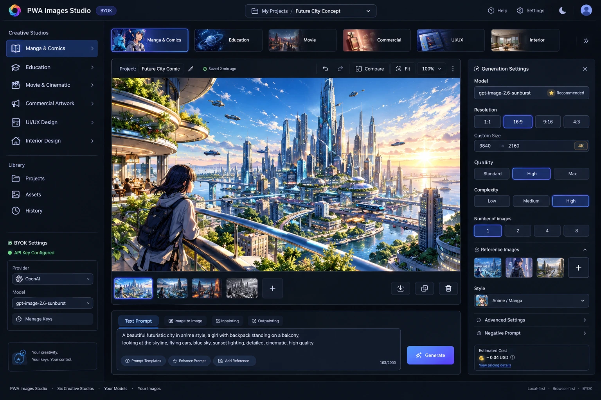
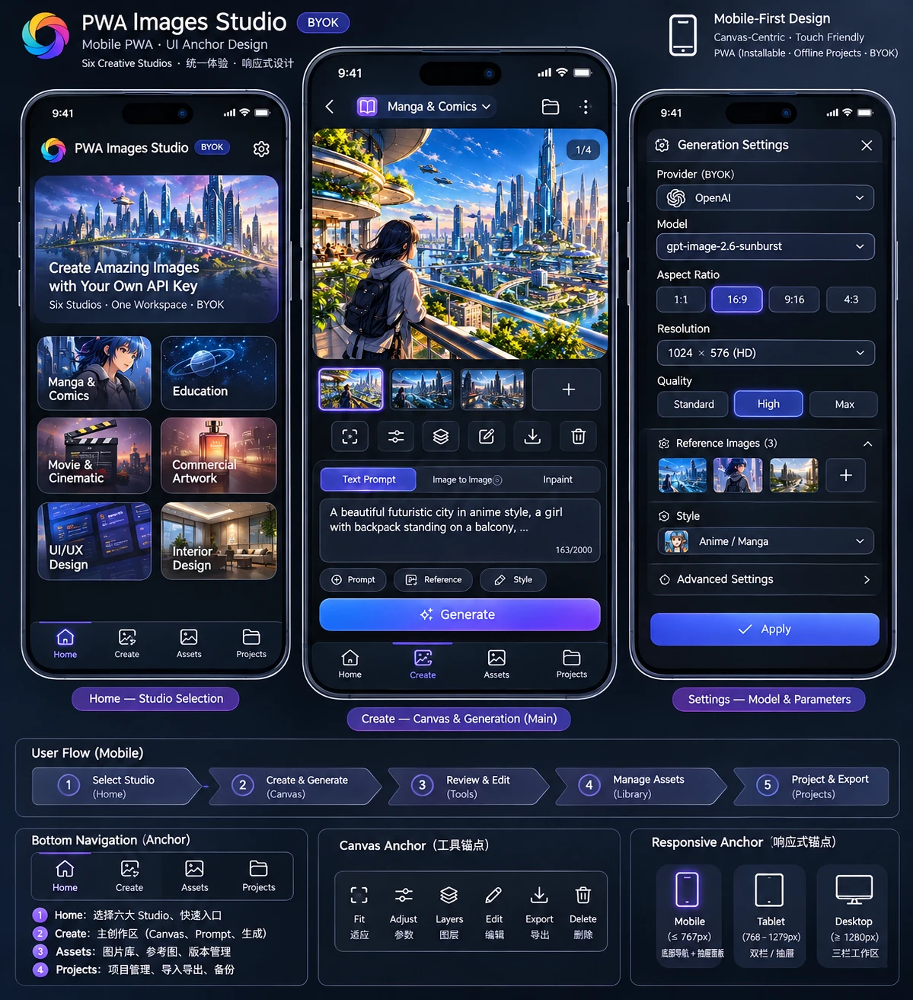

# UI/UX Design System V1

> Status: **Draft proposal. Planning only.** Nothing is implemented. The layouts below are conceptual wireframes for structure, not final visual design.
> Under the project's UI taste gate (`ui:taste-gate-before-merge`), the real UI must be judged from real screenshots before it is accepted. This document does not replace that review.

## 1. Goal

One professional, consistent, modular interface for all six studios. The studios share navigation, Canvas, Prompt Composer, Model Settings, and Asset Library.

## 1a. Visual Anchor V1 (desktop)



File: `docs/ui/anchors/anchor-v1-desktop.webp` (1535x1023). Owner-selected on 2026-11-23 as the **anchor project**: the visual target that the real UI is built toward.

**What the anchor is, and is not**
- It is a generated mockup. It shows direction for layout, density, and mood. It is not a working app and not evidence that anything is implemented.
- Following the taste gate, the real UI is built in HTML and judged from real screenshots against this anchor (390x844, 768x1024, 1440x900). The mockup itself never counts as proof.
- Text and numbers in the image (model name, cost, resolution, prices, "Saved 2 min ago") are placeholder content. They are not verified facts about any provider.

**Structure shown in the anchor**

| Region | Content |
|--------|---------|
| Global header | Logo and name "PWA Images Studio", BYOK badge, project breadcrumb ("My Projects / Future City Concept"), Help, Settings, theme toggle, avatar |
| Studio tab strip | Six studio cards with a preview thumbnail each (removed in the real UI, see decisions below) |
| Left navigation | Six studios, Library (Projects, Assets, History), BYOK Settings with key status, Provider and Model selectors, Manage Keys, short tagline |
| Canvas toolbar | Project name with rename, save status, Undo, Redo, Compare, Fit, zoom percentage, overflow menu |
| Canvas | Large image preview, the dominant element |
| Version strip | Thumbnails of generated versions, add button, Download, Duplicate, Delete |
| Composer | Mode tabs (Text Prompt, Image to Image, Inpainting, Outpainting), prompt box with character count, Prompt Templates, Enhance Prompt, Add Reference, Generate button |
| Right inspector | Model, Resolution presets and custom size, Quality, Complexity, Number of images (1, 2, 4, 8), Reference Images, Style, Advanced Settings, Negative Prompt, Estimated Cost with pricing link |
| Footer | Product line and "Local-first · Browser-first · BYOK" |

Style: dark theme, neutral dark surfaces, a restrained blue-indigo accent for the primary action and selected states, rounded cards, and one dominant image.

**Owner decisions on the anchor differences (2026-11-23)**

| # | Item in the anchor | Decision |
|---|--------------------|----------|
| 1 | Studio tab strip with thumbnails, plus left navigation | Keep **only the left navigation**. Remove the top studio tab strip. On mobile, the Studio bottom tab opens the studio list. |
| 2 | Provider and Model shown on both the left and the right | Provider, Key status, and Manage Keys live in the **left panel**. Model, size, quality, and per-generation settings live in the **right inspector**. |
| 3 | Avatar in the header | **Remove it.** The project has no accounts. Help, Settings, and the theme toggle stay. |
| 4 | "Complexity" setting | **Remove it** for now. Add it back only if a provider has a matching parameter (check in T-104). |
| 5 | 4K badge on custom size | Shown only when the selected model supports it. Otherwise **disabled with a reason**. |
| 6 | Estimated Cost | A **simple version in Phase 1**: shown only where the provider's price is known, clearly labelled as an estimate. SPEC F-09 moves from Phase 4 to Phase 1 (basic). |
| 7 | Inpainting and Outpainting tabs | Before Phase 3, shown **disabled with an explanation**. |
| 8 | Studio preview thumbnails | **Not used.** Studios use icons plus text. The mockup's pictures are not copied. |

Because the top studio strip is removed, the real UI will deviate from the anchor in that area. The taste gate still compares real screenshots against the anchor for overall composition, density, and mood.

## 2. Design Direction: Canvas-first Creative Workspace

One workspace, not six unrelated pages.

- The Canvas is always the visual center and gets the most space.
- The Prompt Composer is fixed at the bottom, so typing and regenerating never need a page change.
- The left side holds Studio, Projects, and Assets navigation.
- The right side holds Model, Size, Quality, Reference, and other generation parameters.
- All six studios use the same base layout. Only the studio-specific tools change.
- Light and Dark themes, responsive layout, and keyboard shortcuts are supported.
- No heavy 3D, WebGL, or constant animation as ordinary decoration, to protect performance.

## 3. Desktop Layout (three panels)

```text
+--------------------------------------------------------------------+
| Images Studio  (Global Header, 56px)                               |
+------------+--------------------------------------+----------------+
| STUDIOS    |  Project / Image 01          100%    | GENERATION     |
|  Manga     |                                      |  Provider      |
|  Education |                                      |  Model         |
|  Movie     |            Canvas                    |  Ratio         |
|  Commercial|                                      |  Quality       |
|  UI/UX     |                                      |  Images        |
|  Interior  |                                      |  References    |
| LIBRARY    |                                      |                |
|  Projects  +--------------------------------------+                |
|  Assets    | Describe your image...     [Generate]|                |
|  History   |  (Bottom Composer)                   |                |
+------------+--------------------------------------+----------------+
```

| Component | Proposed size |
|-----------|---------------|
| Global Header | 56px |
| Left Navigation | 240px expanded, 64px collapsed |
| Center Canvas | Remaining width |
| Right Inspector | 320px, resizable |
| Bottom Composer | Auto height, typically 100–180px |
| Asset Tray | Collapsible, about 140px |
| Minimum comfortable desktop width | 1280px |

On small laptops the side panels collapse so the Canvas is not squeezed.

## 4. Six Studios: Shared Layout, Specialized Tools

Switching studio keeps the shared interface. What changes is the tools, presets, workflow, and data context.

| Studio | Journey | Specialized tools |
|--------|---------|-------------------|
| Manga | Story → Character → Panel → Page | Character Library, Panel Layout, Dialogue Bubbles, Page Composer |
| Education | Topic → Learning Goal → Diagram → Annotation → Review → Export | Not yet designed |
| Movie | Script → Scene → Shot List → Storyboard → Keyframes → Export | Not yet designed |
| Commercial | Brand → Product Reference → Campaign → Variants → Review → Export | Not yet designed |
| UI/UX | Requirements → Style → Layout → Responsive Variants → Review → Handoff | Not yet designed |
| Interior | Room Photo → Style → Materials → Render → Before/After → Export | Not yet designed |

The draft is saved automatically before a studio switch. Unfinished edits must never be lost by switching.

## 5. Canvas Interaction

The Canvas is the most important component. It must support generating, viewing, and editing.

| Interaction | Expected behavior |
|-------------|-------------------|
| Zoom | Mouse wheel with a shortcut key, or touch pinch |
| Pan | Space + drag, or touch drag |
| Fit to Screen | One action shows the whole image |
| Compare | Before/After and side-by-side |
| Versions | View, select, and restore earlier versions |
| Reference | Drag in or pick a reference image |
| Undo / Redo | Undo and redo local edits |
| Export | Export at the real image size and chosen format |

The Canvas uses **non-destructive editing**. Regenerating creates a new version and never overwrites the original asset.

## 6. Responsive Layout

| Breakpoint | Layout |
|------------|--------|
| Desktop, 1280px and above | Three-panel workspace |
| Tablet, 768–1279px | Canvas plus drawers |
| Mobile, below 768px | Canvas plus bottom tabs |

Mobile has four bottom tabs: **Home, Create, Assets, Projects** (see 6a). Settings open as a panel from the Create screen. The Prompt Composer opens as a bottom sheet so it does not permanently take Canvas space.

### 6a. Mobile Visual Anchor V1



File: `docs/ui/anchors/anchor-v1-mobile.webp`. Owner-selected on 2026-11-23 as the **mobile anchor**, the companion of the desktop anchor. The same rules apply: it is a generated mockup that shows direction, not an implementation, and its text and numbers (model name, resolution, counts) are placeholders. The real mobile UI must be judged from real screenshots at 390x844 (and 430x932) on a real phone-size viewport.

**Three screens shown**

| Screen | Content |
|--------|---------|
| Home: Studio Selection | Header with product name, BYOK badge, settings. A hero banner. Six studio cards in a 2x3 grid. Bottom navigation. |
| Create: Canvas and Generation (main) | Header with a studio switcher dropdown, project folder, and menu. Large canvas with an image counter (1/4). Version thumbnails with an add button. Tool row: Fit, Adjust, Layers, Edit, Export, Delete. Composer with mode tabs (Text Prompt, Image to Image, Inpaint), prompt box with character count, chips (Prompt, Reference, Style), and a full-width Generate button. |
| Settings: Model and Parameters | A sheet with Provider (BYOK), Model, Aspect Ratio, Resolution, Quality, Reference Images, Style, Advanced Settings, and an Apply button. |

**Bottom navigation (anchor):** Home (studio selection, quick entry), Create (canvas, prompt, generate), Assets (image library, references, version management), Projects (project management, import/export, backup).

**Mobile user flow:** 1 Select Studio (Home) → 2 Create and Generate (Canvas) → 3 Review and Edit (Tools) → 4 Manage Assets (Library) → 5 Project and Export (Projects).

**Responsive anchor:** Mobile up to 767px (bottom navigation plus drawer), Tablet 768–1279px (two columns or drawer), Desktop 1280px and above (three-panel workspace). This matches section 6.

**Owner decisions on the mobile anchor (2026-11-23)**

| # | Item | Decision |
|---|------|----------|
| 1 | Bottom tabs | **Home, Create, Assets, Projects.** Settings are a panel inside the Create screen. Projects holds project management, import/export, and backup. |
| 2 | Studio cards on Home | **Icon plus text**, the same rule as desktop. No picture cards. |
| 3 | Home opening | **Recent projects plus Continue creating.** A short onboarding hint appears only when there are no projects. No promotional banner. |
| 4 | UI language | **English and Simplified Chinese, switchable.** All UI strings go through an i18n layer from the start. |
| 5 | Inpaint tab and Layers tool | Follow desktop decision 7: **disabled with an explanation** before Phase 3. |

**Still open (mobile)**
- "Adjust" and "Edit" tools are not defined in the spec. They need a definition or removal.
- Provider and Model appear together in the Settings sheet on mobile. This is acceptable because mobile has no left panel, but confirm when T-111 starts.

## 7. Design Tokens

- Default theme: Dark. Neutral dark grey, a restrained indigo accent, a clear type hierarchy, and an 8px spacing system.
- Light theme uses its own semantic color values. It is not a simple inversion of Dark.
- Exact token values are not decided yet.

## 8. UI/UX Acceptance Criteria

- Navigation, Canvas, and Composer are the same across all six studios.
- Switching studio never loses a project or an unfinished draft.
- The Canvas supports zoom, pan, fit to screen, and version comparison.
- When a provider does not support a capability, the UI disables it and explains why.
- After a failed generation, the prompt and references are kept. A request that may be billed is never retried automatically.
- Desktop, tablet, and mobile can all complete the core generation flow.
- Keyboard navigation, visible focus, touch operation, and reduced motion are supported.
- Switching between Light and Dark does not change project content.

## 9. Relationship to Project Standards

- PWA behavior follows `pwa:product-standard` (safe areas, 16px inputs, touch targets about 44px, no horizontal overflow).
- Visual quality is judged by the taste gate: real screenshots at 390x844, 768x1024, and 1440x900, with no card-grid template look and one dominant idea per screen.
- Studio-specific tools for Education, Movie, Commercial, UI/UX, and Interior are still to be designed.

## 10. Open Questions

- Exact color tokens, typography, and the final visual style (needs a high-fidelity mockup reviewed on real screens).
- Layer and Mask editing scope (Phase 3).
- Keyboard shortcut map.
- Detailed mobile interaction design.
